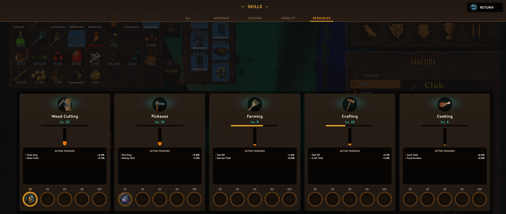
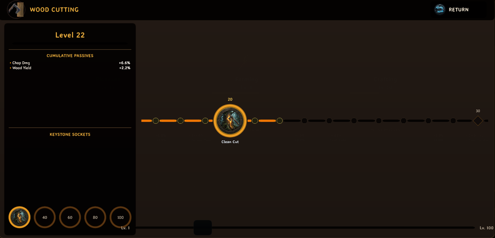

# VikingSkills

**VikingSkills** transforms Valheim's skills interface into a full-screen, panoramic Nordic **Rune Sanctuary HUD** featuring individual skill progression pillars, sub-level XP tracking, and milestone-socketed **Keystone Skill Trees** powered by VikingLib.

> [!WARNING]
> **Work in Progress (Pre-Release v0.1.0)**: This mod is in active development and has not been tested extensively. Features, balance, and mechanics may change, and unintended bugs or edge cases may occur. Backup your character and world saves before testing.

> [!IMPORTANT]
> **Powered by VikingLib**: This mod requires [VikingLib](https://valheim.thunderstore.io/package/DigitalVikings/VikingLib/). 
> VikingLib replaces Valheim's native combat calculation and stat engines. Not all mods may be compatible / work as expected with this.

---

## How It Works

Opening your skills menu displays an expansive horizontal sanctuary tracking all discovered proficiencies:

- **Dedicated Rune Pillars**: Every skill features a vertical glowing pillar displaying progression from Level 0 to 100, live sub-level percentages, and milestone notches at levels 25, 50, 75, and 100.
- **Interactive Keystone Trees**: Clicking any skill pillar opens its dedicated **Rune Tree Drawer**. At each milestone (levels 25, 50, 75, 100), choose and socket 1 of 2 thematic passive Keystones (Novice, Adept, Master, and Legendary rites).
- **Dynamic Stat Integration**: Socketed Keystones inject declarative stat bonuses into VikingLib, modifying weapon damage, attack speed, sprint efficiency, jump costs, stealth, and resource extraction yields.
- **Seamless Character Persistence**: Socketed keystones and active pillars save cleanly into native character metadata (`Player.m_customData`), surviving multiplayer disconnects and server hops without custom network ZDOs.

<b>Click to expand Skill Categories & Archetypes</b>

Filter and pan across archetypes via category tabs at the top of the sanctuary:

| Category | Archetype Glow | Included Skills |
| :--- | :--- | :--- |
| **[⚔ WEAPONS]** | Crimson Ember | Swords, Knives, Clubs, Polearms, Spears, Axes, Bows, Crossbows, Unarmed |
| **[🛡 DEFENSE]** | Steel Azure | Blocking, Dodging |
| **[🔮 MAGIC]** | Mystic Purple | Elemental Magic, Blood Magic |
| **[🏃 MOBILITY]** | Amber Sun | Run, Jump, Sneak, Swim |
| **[🌲 RESOURCES]** | Forest Jade | Woodcutting, Pickaxes, Farming, Crafting, Cooking, Fishing |

<b>Click to expand Milestone Keystone Progression (Tiers I–IV)</b>

| Milestone | Tier | Rite Classification | Description |
| :--- | :--- | :--- | :--- |
| **Level 25** | Tier I | Novice Rite | Foundational efficiency and handling improvements for the active discipline. |
| **Level 50** | Tier II | Adept Rite | Specialized mechanical enhancements altering stamina costs and attack tempo. |
| **Level 75** | Tier III | Master Rite | High-tier mastery granting substantial situational damage or utility bonuses. |
| **Level 100** | Tier IV | Legendary Rite | Pinnacle capstone passive unlocking unique combat procs or major resource multipliers. |

