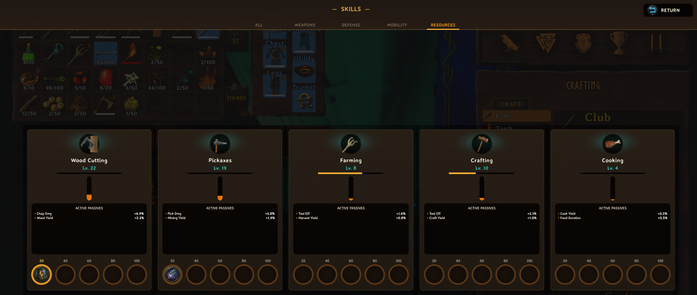
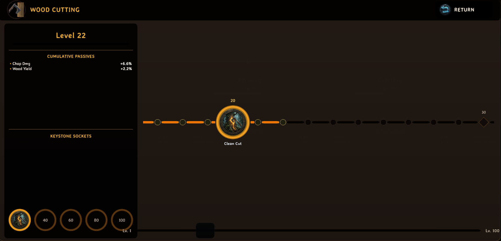

# VikingSkills

**VikingSkills** transforms Valheim's skills interface into a panoramic Nordic **Rune Sanctuary**, replacing shallow passive creep with **240 bespoke Keystone talents** across all **24 skills** and grounding character specialization in **Hearthside Rested Attunement**.

> ⚡ **Powered by VikingLib**: Requires [VikingLib](https://valheim.thunderstore.io/package/DigitalVikings/VikingLib/) by **DigitalVikings**.
> VikingLib provides the shared combat, stat, and skill architecture powering VikingSkills.

---

## Key Features

- **240 Bespoke Keystones Across All 24 Skills**: Every vanilla skill features **5 milestone sockets** at levels **20, 40, 60, 80, and 100**, each offering a meaningful choice between 2 thematic Keystones — complete with **240/240 hand-finished runic emblems**.
- **Hearthside Rested Attunement**: Socketing or swapping Keystones is grounded in Valheim's survival loop. Attuning higher-tier rites requires being **Rested** (or actively Resting) by a hearth of sufficient **Comfort** (`1 / 4 / 8 / 12 / 16` by default). Already-socketed Keystones remain active everywhere even after your Rested buff expires, and comfort mods automatically count toward your total.
- **Panoramic Rune Sanctuary HUD**: Browse all discovered skills on a full-screen Nordic sanctuary organized by archetype tabs, inspect live sub-level XP bars, and open any skill's scrollable **Level 1–100 Timeline Drawer** to preview or attune talents.
- **Pure Milestone Progression (Configurable)**: By default, individual skill levels no longer cause silent stat bloat — power flows intentionally from your chosen Keystones. Admins can re-enable vanilla fractional scaling at any time.
- **Flexible XP & Death Penalty Controls**: Tune global or per-category skill gain multipliers, configure death skill loss (`None`, `Percentage`, or `FlatLevels`), and protect unlocked milestone floors so dying never strips active Keystones.
- **Save-Safe Character Persistence**: Active Keystones are stored cleanly in native character metadata and survive multiplayer sessions, mod updates, and server transfers without custom world objects.

---

<b>Skill Categories & Archetypes (24 Skills / 240 Keystones)</b>

Filter across five archetype tabs at the top of the Rune Sanctuary:

| Category | Archetype Glow | Included Skills | Keystones |
| :--- | :--- | :--- | :---: |
| **WEAPONS** | Crimson Ember | Axes, Clubs, Swords, Spears, Polearms, Knives, Unarmed, Bows, Crossbows | 90 |
| **DEFENSE** | Steel Azure | Blocking, Dodge | 20 |
| **MAGIC** | Mystic Purple | Elemental Magic, Blood Magic | 20 |
| **MOBILITY** | Amber Sun | Run, Jump, Sneak, Swim, Ride | 50 |
| **RESOURCES** | Forest Jade | Woodcutting, Pickaxes, Farming, Crafting, Cooking, Fishing | 60 |

<b>Milestone Tiers & Hearthside Comfort Thresholds (Tiers I–V)</b>

Each milestone unlocks 2 distinct Keystone options. With Hearthside Attunement enabled, socketing or swapping talents at each tier requires resting at a hearth meeting that tier's Comfort threshold (all values configurable):

| Milestone | Tier | Default Comfort | Role |
| :--- | :---: | :---: | :--- |
| **Level 20** | Tier I | **Comfort 1+** (Campfire) | Foundational efficiency, handling, and early specialization. |
| **Level 40** | Tier II | **Comfort 4+** (Basic Shelter) | Specialized combat tempo, stamina flow, and utility shifts. |
| **Level 60** | Tier III | **Comfort 8+** (Cozy Homestead) | Mid-game mastery unlocking strong situational procs and multipliers. |
| **Level 80** | Tier IV | **Comfort 12+** (Longhouse) | High-tier synergy combining dual combat or survival strengths. |
| **Level 100** | Tier V | **Comfort 16+** (Grand Mead Hall) | Pinnacle capstone defining your Viking's archetype mastery. |

---

## Configuration

All balance-affecting settings are **server-authoritative** (automatically synced to clients in multiplayer when Jötunn is installed) and organized into five clean sections in `com.digitalvikings.vikingskills.cfg`:

- **`01 - General`**: Master enable toggle, vanilla fractional skill scaling toggle, and UI/attunement audio effects.
- **`02 - Visual Theme`**: Custom hex accent colors for each of the five skill category tabs and rune glows.
- **`03 - Progression - Skill Loss on Death`**: Choose `None`, `Percentage`, or `FlatLevels`, configure exact loss values, and toggle milestone floor protection.
- **`04 - Progression - Skill Gain Multipliers`**: Exact global and per-category XP multipliers overriding vanilla world modifiers.
- **`05 - Hearthside Attunement`**: Master toggle (disable to allow swapping Keystones anywhere), Rested/Resting status requirement toggle, and per-tier Comfort thresholds (`Lv20`, `Lv40`, `Lv60`, `Lv80`, `Lv100`).

---

## Installation & Requirements

1. Install **BepInExPack Valheim**.
2. Install **DigitalVikings-VikingLib** (required) and **Jötunn** (recommended for multiplayer config sync).
3. Install **DigitalVikings-VikingSkills** via your mod manager (Gale / r2modman) or extract into `BepInEx/plugins/`.

---

Created by **DigitalVikings**.
